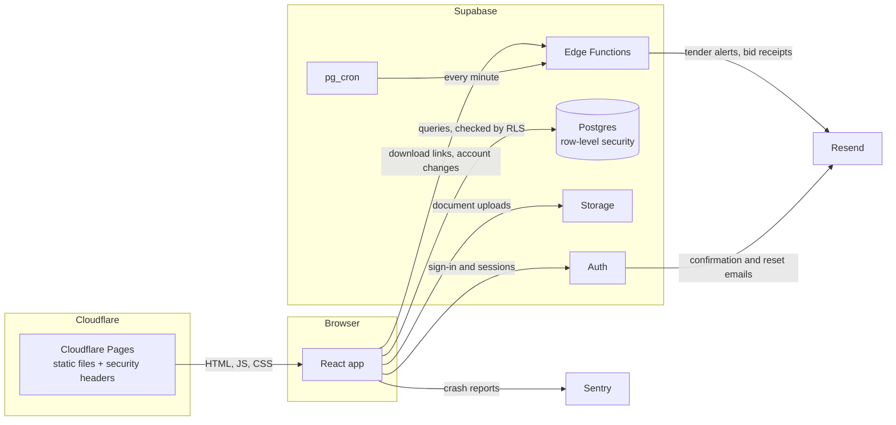
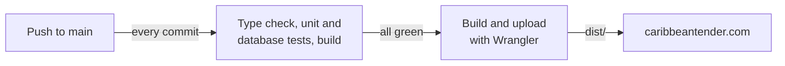

<div align="center">

<a href="https://caribbeantender.com">
  <picture>
    <source media="(prefers-color-scheme: dark)" srcset="src/assets/brand/logo-mark-light.webp">
    
  </picture>
</a>

# CaribbeanTender

**The private procurement platform for the Caribbean.**<br>
Businesses post tenders. Suppliers send sealed bids that nobody can open before the deadline.

[](https://github.com/caribbeantender2026-cell/caribbeantender/actions/workflows/ci.yml)
[](https://caribbeantender.com)

[](https://react.dev)
[](https://www.typescriptlang.org)
[](https://vite.dev)
[](https://tailwindcss.com)
[](https://supabase.com)
[](https://pages.cloudflare.com)
[](https://pnpm.io)

[**Live site**](https://caribbeantender.com) · [Features](#features) · [Getting started](#getting-started) · [Architecture](#architecture) · [Testing](#testing) · [Deployment](#deployment)

</div>

---

## Features

### For businesses

- Post a tender with a category, a closing date and supporting documents. Save it as a draft first if you need to.
- Bids stay sealed until the closing time. After that, open them, compare them and award the tender.
- Cancel a tender with a reason, which is shown on the tender's page.

### For suppliers

- Browse open tenders by category, with a live countdown to each deadline.
- Send one sealed bid per tender and get a receipt straight away. Bids can't be changed after they are sent.
- Get an email when a tender opens in your category, and a reminder 24 hours before it closes if you haven't bid yet.

### Across the platform

- One sign-in for both account types, with a switch in the account menu.
- An optional picture for each account, shown next to its company name on tenders and bids.
- Ready-made forms (registrations, requirements, proposals) that save as drafts and download as PDFs.
- An admin area behind two-factor sign-in, for deactivating accounts and cancelling tenders.
- Tender documents are shared through download links that expire after 60 seconds.

## Tech stack

| Layer | Tools |
|---|---|
| App | React 19, React Router, TypeScript, Vite, Tailwind CSS 4 |
| Data and forms | TanStack Query, React Hook Form, Zod |
| Backend | Supabase: Postgres with row-level security, Auth, Storage, Edge Functions (Deno) and `pg_cron` |
| Email | Resend, for app emails and for Supabase Auth over SMTP |
| Hosting | Cloudflare Pages and Cloudflare DNS |
| Monitoring | Sentry, errors only (no session replay) |
| Testing | Node's built-in test runner, PGlite (Postgres in memory), Playwright |
| Tooling | pnpm, GitHub Actions |

## Architecture



The app is a static single-page app: it has no server of its own. Every rule about who can read or change what lives in the database as row-level security, so the same rules hold whether a request comes from the app or straight from the API.

## Getting started

### Prerequisites

- Node.js 22.18 or later
- pnpm 10 (`corepack enable`). Never use npm in this repo.
- The [Supabase CLI](https://supabase.com/docs/guides/local-development/cli/getting-started), only for migrations, type generation and the live tests

### Install and run

```bash
git clone https://github.com/caribbeantender2026-cell/caribbeantender.git
cd caribbeantender
pnpm install
pnpm dev          # http://localhost:5173
```

### Environment files

Copy the blocks of [`.env.example`](.env.example) into the files it names.

| File | Committed | What it holds |
|---|---|---|
| `.env.production` | Yes | Public build settings for the live site: the Supabase URL, the publishable key, the Sentry DSN and the support address. Never secrets. |
| `.env.local` | No | The same public settings, for local development |
| `.env.production.local` | No | For scripts only. Holds the Supabase secret key: never print it or commit it. |

> [!IMPORTANT]
> There is no staging project yet. Local runs and the live test suites use the production Supabase project, so anything made for testing uses a clearly named test account and is removed afterwards. Never change or delete real users' data.

## Scripts

| Command | What it does |
|---|---|
| `pnpm dev` | Starts the app at http://localhost:5173 |
| `pnpm build` | Type checks, then builds `dist/` |
| `pnpm typecheck` | Type checks the app and the scripts |
| `pnpm types` | Regenerates `src/lib/database.types.ts` from the linked project. Run it after every migration. |

## Testing

| Command | Where | What it proves |
|---|---|---|
| `pnpm test` | `tests/app`, `tests/functions` | App rules, forms, PDF output, the email allowlist and email wording |
| `pnpm test:database` | `tests/database` | Migrations and RLS policies, on PGlite, an in-memory Postgres (no Docker needed) |
| `pnpm test:database:before-after` | `tests/database` | Every database fix fails before its migration and passes after it |
| `pnpm test:rls:live` | `tests/rls` | Each role reaches only what it should, on the live project. Each run leaves a record in `tests/rls/runs/`. |
| `pnpm test:e2e` | `tests/e2e` | In Google Chrome, against the live project: a business posts a tender, a supplier bids, and the business awards it |

The live suites create their own test accounts already confirmed and delete everything they made when they finish. Run records are written only by the runner: never edit them by hand.

## Deployment



- **Site:** every push to `main` runs the checks. When they all pass, the `deploy` job publishes `dist/` to Cloudflare Pages and records it under the repo's **production** environment. It needs two repository secrets: `CLOUDFLARE_API_TOKEN` (Cloudflare Pages: Edit) and `CLOUDFLARE_ACCOUNT_ID`.
- **Headers:** [`public/_headers`](public/_headers) sets a strict Content Security Policy, HSTS and the other security headers. Hashed files under `/assets/` are cached for a year.
- **Database and functions:** migrations and Edge Functions are deployed by hand with the Supabase CLI, not by CI. Migrations are applied one at a time with `supabase db push --linked`, after they are committed.
- **Email:** until launch, the `EMAIL_ALLOWLIST` Edge Function secret limits app emails to a short list of addresses. At launch it changes to `*`. Every email uses one branded frame (`brandedEmail` in `supabase/functions/send-notifications/notifications.ts`). `node scripts/write-auth-email-templates.ts` writes the same frame into `supabase/templates/` for the Supabase Auth emails, which are pasted into Authentication > Emails > Templates.

## Security

- **Row-level security on every table.** The database decides what each role can see, and the live suite checks every role against every table.
- **Sealed bids.** Before a tender closes, only the supplier who sent a bid can see it: not the business, not admins, not even how many bids there are. Bids on a tender cancelled before its deadline are never opened.
- **Two-factor sign-in for admins.** The admin area requires an authenticator app.
- **Logged, short-lived downloads.** Nobody reads stored files directly. Each download is checked, logged, and given a link that expires after 60 seconds.
- **Locked-down browser.** A strict Content Security Policy, HSTS, no framing, and a minimum of TLS 1.2.
- **No secrets in the repo.** Only public keys are committed. Everything else lives in GitHub, Supabase or Cloudflare secrets.

Found a security problem? Email **support@caribbeantender.com** rather than opening a public issue.

## Project structure

```text
caribbeantender/
├── public/                 # _headers, _redirects and icons, copied into the build as they are
├── src/
│   ├── pages/              # One file per screen, loaded on demand
│   ├── components/         # Shared UI: the page frame, dialogs, the tender view, the demo
│   ├── auth/               # The signed-in account and its business or supplier profile
│   ├── lib/                # Business rules, time formatting, the Supabase client and its types
│   ├── content/            # Site text in Markdown
│   ├── styles/             # Tailwind theme and shared styles
│   └── assets/             # The logo and photos
├── supabase/
│   ├── migrations/         # Every database change, in order
│   ├── go-live/            # Migrations held back until launch
│   └── functions/          # download-document, send-notifications, set-user-active
├── scripts/                # Backups, cleanup, the RLS runner, type generation, the email templates
├── tests/                  # app, functions, database, rls, e2e
└── .github/workflows/      # CI and deployment
```

## Documentation

The requirements (`PRD.md`) and the project documents (the deployment guide, open questions and the security audit) are kept out of this public repository on purpose. Ask the maintainers for a copy.

## License

This is a client project. It has no open-source license.
